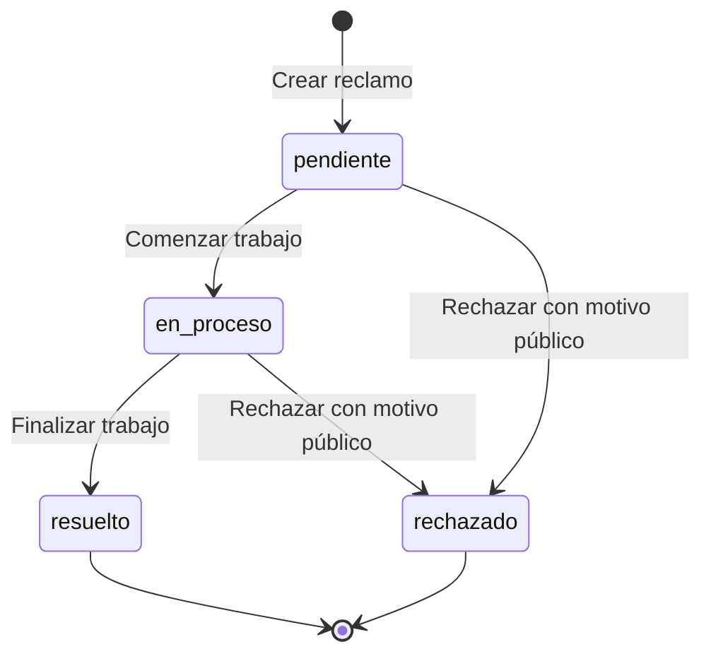

# Máquina de estados de reclamos

Consultar también el [modelo de datos](modelo-datos.md) y las [reglas del sistema](reglas-sistema.md).

| Estado | Significado | Cuenta para el límite de tres activos |
| --- | --- | --- |
| `pendiente` | Registrado; el trabajo todavía no comenzó | Sí, si no tiene baja lógica |
| `en_proceso` | Comenzó la atención del reclamo | Sí |
| `resuelto` | El trabajo terminó | No |
| `rechazado` | No se atenderá; tiene un motivo público | No |

## Transiciones

| Transición | Quién la realiza | Condiciones / detalle |
| --- | --- | --- |
| Creación → `pendiente` | Vecino, u operario en función de vecino, no suspendido | Menos de tres reclamos propios activos; observación no necesaria |
| `pendiente` → `en_proceso` | Responsable asignado (operario o admin autoasignado) | Observación opcional |
| `en_proceso` → `resuelto` | Cualquier operario o admin | Observación obligatoria, pública o interna |
| `pendiente` o `en_proceso` → `rechazado` | Admin | Observación obligatoria y pública; indicar si el reclamo era falso, lo que crea una [sanción](reglas-sistema.md#sanciones) |
| `pendiente` o `en_proceso` → `rechazado` por falso | Cualquier operario | Observación obligatoria y pública; siempre crea una [sanción](reglas-sistema.md#sanciones). Los rechazos por otros motivos los hace el admin |

`resuelto` y `rechazado` son estados finales: no hay reapertura, vuelta atrás ni transición entre ellos. No se permite pasar directamente de `pendiente` a `resuelto`. Los cambios se registran según [Historial y observaciones](#historial-y-observaciones).

La asignación es independiente del estado: un reclamo asignado sigue `pendiente` hasta que su responsable comienza el trabajo. Un operario puede tomar para sí un reclamo pendiente sin responsable; el administrador puede asignarlo a un operario activo o a sí mismo, y reasignarlo mientras siga pendiente. Se guardan el responsable, autor y fecha de la asignación actual, además del último responsable desasignado, quién lo desasignó y cuándo. Reasignar directamente a otra persona registra la salida del responsable anterior como última desasignación. Una nueva desasignación reemplaza la anterior; no se mantiene un historial completo de asignaciones. El inicio exige que quien actúa sea el responsable asignado y registra la transición en el historial de estados.

La API de personal usa `POST /api/reclamos/{id}/asignacion` con `responsable_id` para tomar o asignar, `POST /api/reclamos/{id}/comenzar` para iniciar y `GET /api/reclamos/{id}/trabajo` para consultar la asignación. El admin puede quitar la asignación de un reclamo pendiente con `DELETE /api/reclamos/{id}/asignacion`. Para rechazar un reclamo pendiente o en proceso usa `POST /api/reclamos/{id}/rechazar` con `observacion` obligatoria y `es_falso` booleano obligatorio. El rechazo registra la observación pública y aplica la sanción si corresponde. Las operaciones de escritura devuelven conflicto si el reclamo ya no cumple las condiciones.

El personal consulta `GET /api/trabajo/reclamos?vista=asignados` para sus reclamos activos y `vista=disponibles` para los pendientes sin responsable. El resultado usa paginación por cursor; el mapa debe recorrer todas las páginas para no omitir reclamos. `GET /api/trabajo/reclamos/{id}` devuelve el detalle y el historial para el personal autenticado. Ambos accesos requieren rol de empleado o admin y cuenta activa.

## Baja lógica

La baja lógica no es un estado. Solo se permite bajo las [condiciones de eliminación del vecino](reglas-sistema.md#edición-y-eliminación-de-reclamos). Un reclamo con `deleted_at` deja de contar como activo, no admite transiciones ni nuevas interacciones y conserva sus datos para consulta administrativa. No se contempla restauración en el MVP.

## Historial y observaciones

La creación registra el estado inicial. Cada transición actualiza `reclamos.estado_id` y `updated_at` y agrega una fila al historial dentro de una misma transacción. El autor es el usuario que actuó o `null` si fue el sistema; así queda registrado qué operario trabajó en cada reclamo. El historial no se edita ni se borra.

El detalle administrativo entrega estos registros ordenados por fecha y, en caso de empate, por id. Los reclamos creados antes de registrar el estado inicial pueden no tener esa fila; su fecha de creación sigue disponible en el reclamo y no se inventan registros históricos.

Las fechas de resolución y rechazo se obtienen de `created_at` de la transición al estado final. No se guardan `resuelto_en` ni `rechazado_en` en `reclamos`.

| Estado destino | Observación | Visibilidad |
| --- | --- | --- |
| `pendiente` al crear | No necesaria | Pública por defecto |
| `en_proceso` | Opcional | Pública o interna |
| `resuelto` | Obligatoria: detalle de finalización | Pública o interna |
| `rechazado` | Obligatoria: motivo del rechazo | Siempre pública |

Quien registra el cambio elige la visibilidad, excepto en el rechazo. Las observaciones internas solo son visibles para operarios y administradores y se filtran en el backend. Las observaciones públicas las ve cualquier usuario. Las observaciones del historial no son comentarios de vecinos ni consumen su límite.

Los cambios automáticos del sistema respetan las mismas transiciones, condiciones y requisitos de observación y visibilidad. Por ahora no se define ninguna automatización concreta.

## Efectos sobre las demás tablas

| Tabla | Efecto del estado del reclamo |
| --- | --- |
| `users` | No cambia el rol; resolver o rechazar libera un lugar del límite de reclamos activos del creador; un rechazo por falso puede completar `suspendido_hasta` |
| `estados_reclamo` | El catálogo permanece igual; cada reclamo referencia su estado actual |
| `historial_estados_reclamos` | Agrega un registro por transición con estado destino, autor, fecha, observación y visibilidad; permite obtener la fecha de finalización |
| `comentarios` | Permite crear comentarios y editar o eliminar los propios solo en pendiente o en proceso; conserva y congela los existentes al finalizar |
| `votos` | Permite dar, cambiar o quitar votos solo en pendiente o en proceso; conserva los existentes al finalizar. Los votos nunca provocan una transición |
| `fotos_reclamo` | Permite agregar o quitar fotos solo mientras el reclamo sea editable; conserva las existentes al finalizar |
| `sanciones` | Un rechazo marcado como falso crea una sanción para el creador en la misma transacción; las demás transiciones no la afectan |
| `tipos_reclamo` | La categoría no cambia por una transición de estado |
