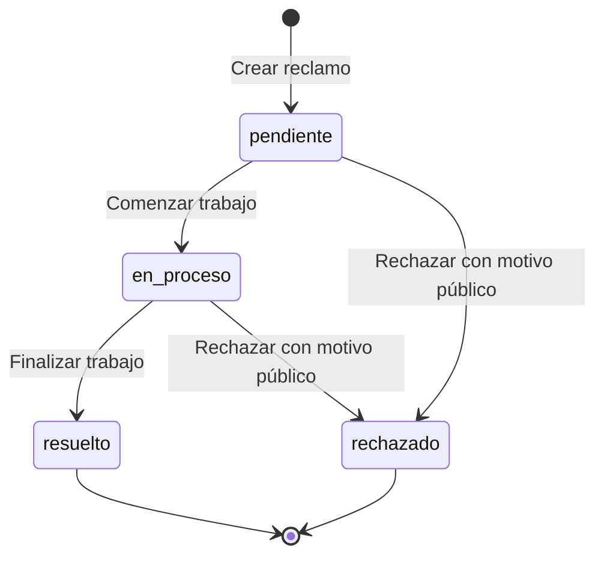

# Máquina de estados de reclamos

Consultar también el [modelo de datos](modelo-datos.md) y las [reglas del sistema](reglas-sistema.md).

| Estado | Significado | Cuenta para el límite de tres activos |
| --- | --- | --- |
| `pendiente` | Registrado; el trabajo todavía no comenzó, aunque puede estar asignado | Sí, si no tiene baja lógica |
| `en_proceso` | Comenzó la atención del reclamo | Sí |
| `resuelto` | El trabajo terminó | No |
| `rechazado` | No se atenderá; tiene un motivo público | No |

## Transiciones

| Transición | Quién la realiza | Condiciones / detalle |
| --- | --- | --- |
| Creación → `pendiente` | Ciudadano verificado, incluido empleado en función ciudadana | Menos de tres reclamos propios activos; observación no necesaria |
| `pendiente` → `en_proceso` | Empleado autorizado por la asignación o admin | Tener empleado o cuadrilla asignada; observación opcional |
| `en_proceso` → `resuelto` | Empleado autorizado por la asignación o admin | Observación obligatoria, pública o interna |
| `pendiente` o `en_proceso` → `rechazado` | Admin | Observación obligatoria y pública |

`resuelto` y `rechazado` son estados finales: no hay reapertura, vuelta atrás ni transición entre ellos. No se permite pasar directamente de `pendiente` a `resuelto`. Los cambios se registran según [Historial y observaciones](#historial-y-observaciones).

## Asignación y baja lógica

Asignar o reasignar no es una transición: un reclamo pendiente puede estar asignado y uno en proceso permanece en proceso si cambia su responsable. La asignación puede modificarse mientras esté pendiente o en proceso; queda sin cambios al finalizar. El historial de estados no registra reasignaciones; para el MVP solo se guarda la asignación actual o final.

La baja lógica tampoco es un estado. Solo se permite bajo las [condiciones de eliminación del ciudadano](reglas-sistema.md#edición-y-eliminación-de-reclamos). Un reclamo con `deleted_at` deja de contar como activo, no admite transiciones ni nuevas interacciones y conserva sus datos para consulta administrativa. No se contempla restauración en el MVP.

## Historial y observaciones

La creación registra el estado inicial. Cada transición actualiza `reclamos.estado_id` y `updated_at` y agrega una fila al historial dentro de una misma transacción. El autor es el usuario que actuó o `null` si fue el sistema. El historial no se edita ni se borra.

Las fechas de resolución y rechazo se obtienen de `created_at` de la transición al estado final. No se guardan `resuelto_en` ni `rechazado_en` en `reclamos`.

| Estado destino | Observación | Visibilidad |
| --- | --- | --- |
| `pendiente` al crear | No necesaria | Pública por defecto |
| `en_proceso` | Opcional | Pública o interna |
| `resuelto` | Obligatoria: detalle de finalización | Pública o interna |
| `rechazado` | Obligatoria: motivo del rechazo | Siempre pública |

Quien registra el cambio elige la visibilidad, excepto en el rechazo. Las observaciones internas solo son visibles para empleados y administradores y se filtran en el backend. Las observaciones públicas son visibles para todos cuando el reclamo es público; cuando es privado, solo las ven el creador y el personal autorizado para gestionarlo. El estado y la fecha respetan la privacidad general del reclamo: en un reclamo privado solo los ven esas mismas personas autorizadas. Las observaciones del historial no son comentarios ciudadanos ni consumen su límite.

Los cambios automáticos del sistema respetan las mismas transiciones, condiciones y requisitos de observación y visibilidad. Por ahora no se define ninguna automatización concreta.

## Efectos sobre las demás tablas

| Tabla | Efecto del estado del reclamo |
| --- | --- |
| `users` | No cambia rol ni verificación; resolver o rechazar libera un lugar del límite de reclamos activos del creador |
| `estados_reclamo` | El catálogo permanece igual; cada reclamo referencia su estado actual |
| `historial_estados_reclamos` | Agrega un registro por transición con estado destino, autor, fecha, observación y visibilidad; permite obtener la fecha de finalización |
| `comentarios` | Permite crear comentarios y editar o eliminar los propios solo en pendiente o en proceso; conserva y congela los existentes al finalizar |
| `votos` | Permite dar o quitar votos solo en pendiente o en proceso; conserva los existentes al finalizar |
| `tipos_reclamo` | La categoría no cambia por una transición de estado |
| `cuadrillas` | No modifica integrantes; se conserva la asignación actual o final del reclamo |
